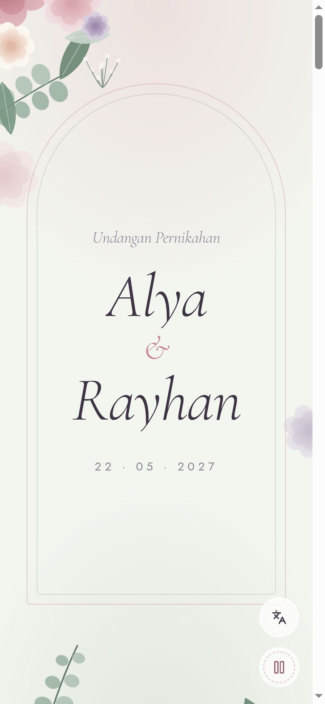
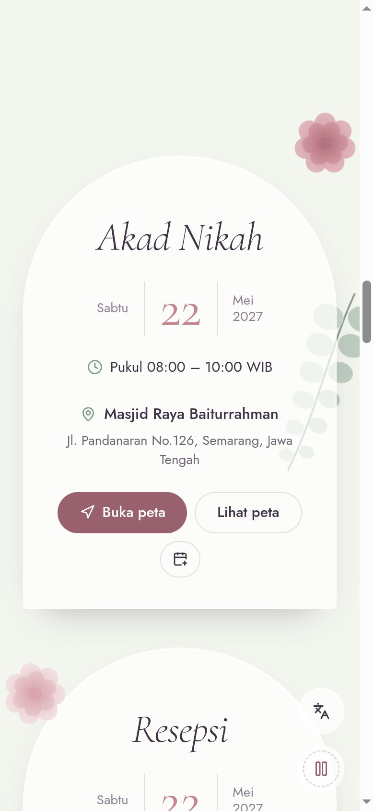
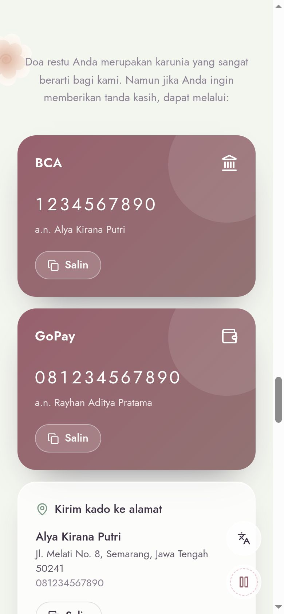
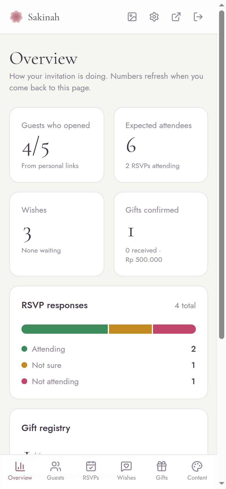
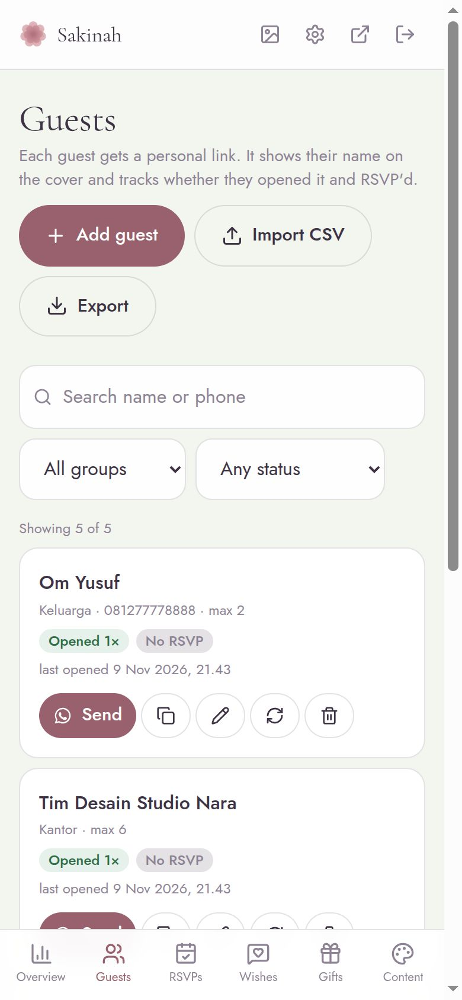
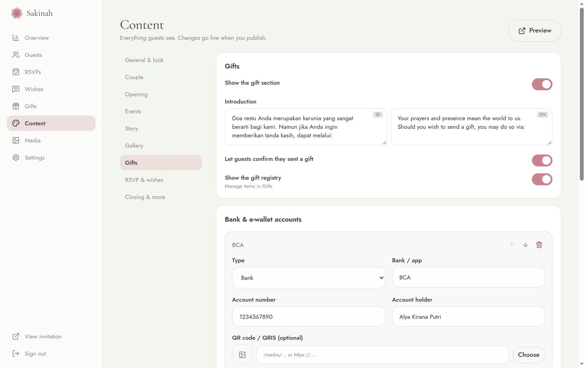

# Digital Wedding Invitation

A self-hosted, mobile-first wedding invitation with a real-time 3D envelope, layered
garden animations, RSVP, wishes, gift tracking and an admin dashboard where **everything
is editable** — no code, no redeploys. One wedding per deployment, runs anywhere Docker runs.

<p align="center">
  
  
  
  
</p>

## What guests get

- **3D envelope cover** with their name (`Kepada Yth. …`). Tapping _Buka Undangan_ cracks the wax seal, opens the flap and lifts out a card with the couple's names; music starts with that tap. Tilts with the phone's gyroscope.
- **Semi-3D scrolling**: vector florals sit on different depth layers that move with scroll and device tilt.
- Quran verse & opening, couple portraits with parents and Instagram, live countdown, **Google Calendar / .ics**, event cards with **Google Maps** links and an embedded map, love-story timeline, gallery with swipe lightbox, livestream link, guest etiquette.
- **Gifts**: bank/e-wallet cards with copy buttons and QRIS, shipping address, "I sent a gift" confirmation, and a **gift registry** where guests pick an item so nobody doubles up.
- **RSVP** with party size (capped per guest) and a **live wishes wall** with attendance badges.
- Bahasa Indonesia + English, background music toggle, fast on mid-range phones (LCP ≈ 1.4 s on a 4× throttled CPU over 4G), respects _reduced motion_ with a lighter 2.5D cover.
- Link previews in WhatsApp show your title and photo.

## What you get (admin at `/admin`)

<p align="center">
  
  
  
</p>

- **Overview**: who opened their invitation, expected attendees, RSVP breakdown, wishes, gifts, opens over 30 days.
- **Guests**: personal links (`/?g=…`) that greet each guest by name and track opens and RSVPs. **Send via WhatsApp** with your own message template, CSV import/export, groups, per-guest party limits.
- **RSVPs, wishes** (hide or require approval), **gift confirmations** (mark received) and the **gift registry**.
- **Content editor** for every section, in both languages: names, events, story, gallery, accounts, colors, music, toggles. Changes go live when you press _Publish_.
- **Media library**: photos are resized, converted to WebP and stripped of location data automatically.
- **Photo editor**: every image upload opens a simple editor first, with crop (with the best ratio for each spot, e.g. 3:4 for the couple's arch portraits), pan and zoom, rotate, mirror and straighten, brightness, contrast, saturation, warmth and filters. The preview updates live, and existing photos can be re-edited.

## Quick start

Requirements: Docker with Compose v2.

```bash
git clone https://github.com/f4ww4z/digital-wedding-invitation.git
cd digital-wedding-invitation
cp .env.example .env
```

Edit `.env` — at minimum:

| Variable         | What to put                                                                                                     |
| ---------------- | --------------------------------------------------------------------------------------------------------------- |
| `PUBLIC_URL`     | The address guests will open, e.g. `https://alya-rayhan.example.com` (used in personal links).                  |
| `SESSION_SECRET` | Output of `openssl rand -base64 48`.                                                                            |
| `ADMIN_PASSWORD` | Your own password (10+ chars), **or leave it empty** and read the generated one from `docker compose logs api`. |
| `COOKIE_SECURE`  | `true` behind HTTPS (default). Set `false` only to try it on plain `http://localhost`.                          |

```bash
docker compose up -d --build
```

Open `http://localhost:8080` for the invitation and `http://localhost:8080/admin` to sign in.
The demo couple (Alya & Rayhan) is there so you can see everything working; replace it in **Content**.

> The example password and secret are refused in production on purpose.

## Putting it online (HTTPS)

The stack serves plain HTTP on one port (`PUBLIC_PORT`, default 8080). Put any TLS-terminating
proxy in front of it:

- **Cloudflare Tunnel** — `cloudflared tunnel --url http://localhost:8080`. Set `TRUST_PROXY=2`.
- **Caddy** — `alya-rayhan.example.com { reverse_proxy localhost:8080 }`. Set `TRUST_PROXY=2`.
- **Nginx Proxy Manager / Traefik** — point at `web:8080` or `localhost:8080`, set `TRUST_PROXY=2`.

When the proxy runs on the same host, set `PUBLIC_BIND=127.0.0.1` so the port isn't exposed directly.
`TRUST_PROXY` is the number of proxies in front of the API (the bundled nginx counts as one); it
must be right for per-IP rate limits to work.

## Configuration

All invitation content lives in the admin dashboard. `.env` is only for infrastructure and secrets:

| Variable                       | Default                 | Purpose                                                                                            |
| ------------------------------ | ----------------------- | -------------------------------------------------------------------------------------------------- |
| `PUBLIC_URL`                   | `http://localhost:8080` | Base for personal links and link-preview images                                                    |
| `PUBLIC_BIND` / `PUBLIC_PORT`  | `0.0.0.0` / `8080`      | Where the web container listens on the host                                                        |
| `ADMIN_USERNAME`               | `admin`                 | Admin login name                                                                                   |
| `ADMIN_PASSWORD`               | —                       | Hashed with argon2id on first boot. Changing it in `.env` resets the password on the next restart. |
| `ADMIN_PASSWORD_HASH`          | —                       | Pre-computed argon2 hash instead of a plaintext password (wrap in single quotes)                   |
| `SESSION_SECRET`               | —                       | ≥ 32 random characters, signs session cookies                                                      |
| `SESSION_TTL_HOURS`            | `168`                   | Admin session lifetime                                                                             |
| `COOKIE_SECURE`                | `true`                  | Send the admin cookie only over HTTPS                                                              |
| `TRUST_PROXY`                  | `1`                     | Proxy hops to trust for client IPs                                                                 |
| `MAX_UPLOAD_MB`                | `15`                    | Largest media upload                                                                               |
| `RATE_LIMIT_PUBLIC_PER_MIN`    | `30`                    | Public form submissions per IP per minute                                                          |
| `RATE_LIMIT_CREATE_PER_HOUR`   | `40`                    | New RSVPs / wishes / gift confirmations / registry picks per IP per hour                           |
| `RATE_LIMIT_LOGIN_PER_15MIN`   | `10`                    | Failed admin logins per IP; the account also locks for 15 min after 10 failures in a row           |
| `TZ`, `LOG_LEVEL`, `IMAGE_TAG` |                         | Time zone, log verbosity, image tag                                                                |

Generate a password hash: `echo 'your-password' | docker compose run --rm -T api node dist/scripts/hash-password.js`

## Guest links and CSV import

Each guest gets a link like `https://your-site/?g=7hKq2mXz9P`. It shows their name on the cover,
pre-fills their RSVP, caps their party size and records when they opened it.
For casual sharing you can also use `/?to=Nama%20Tamu` (shows the name, no tracking).

CSV import accepts a header row with any of: `name`/`nama`, `group`/`grup`, `phone`/`hp`/`wa`,
`pax`/`max_pax`/`jumlah`, `notes`/`catatan`. Comma, semicolon (Excel in Indonesian locale) and tab
separators all work. Indonesian numbers like `0812…` are converted for WhatsApp automatically.

## Backups

```bash
# Database (consistent, safe while running)
docker compose exec api node dist/scripts/backup.js        # prints /data/backups/invitation-<time>.db
docker compose cp api:/data/backups ./backups

# Uploaded photos and music
docker run --rm -v wedding-invitation_uploads:/u -v "$PWD":/b alpine tar czf /b/uploads.tgz -C /u .
```

Restore by stopping the stack and copying the `.db` back to `/data/invitation.db` in the
`wedding-invitation_data` volume. Updating is `git pull && docker compose up -d --build`;
database migrations run automatically on start.

## Security

- Containers run as non-root with read-only filesystems, all Linux capabilities dropped,
  `no-new-privileges`, memory/CPU/PID limits and health checks. The API has no route to the
  internet and is reachable only through nginx.
- Strict Content-Security-Policy (no inline scripts, self-hosted fonts), `X-Frame-Options: DENY`,
  `nosniff`, restrictive `Permissions-Policy`.
- Admin: argon2id passwords, opaque sessions stored hashed, `httpOnly` + `SameSite=Strict` cookies,
  CSRF header on every write, per-IP rate limits plus a persistent account lockout.
- Public forms: schema validation on every field, honeypots, per-IP minute and hour limits.
- Uploads are identified by their bytes (not the file name), images are re-encoded, files get
  random names and are served with `nosniff` and a sandboxing CSP.
- Spreadsheet exports neutralise formula injection.
- Search engines are told not to index the invitation (guest names live in URLs). Turn it on in
  _Content → General_ if you want it public.

See [SECURITY.md](SECURITY.md) to report a vulnerability.

## Development

Requirements: Node 22+ (24 recommended), pnpm 10, and `node-gyp` for native modules
(`npm i -g node-gyp`, plus `python3 make g++`).

```bash
pnpm install
cp .env.example .env    # set SESSION_SECRET, ADMIN_PASSWORD and COOKIE_SECURE=false
pnpm dev                # API on :3000, web on :5173 (proxies /api and /media)
```

| Command                        | What it does                                                      |
| ------------------------------ | ----------------------------------------------------------------- |
| `pnpm lint` / `pnpm typecheck` | ESLint and TypeScript across the workspace                        |
| `pnpm test`                    | Unit and API integration tests (Vitest + Supertest)               |
| `pnpm test:e2e`                | Playwright against a running stack (`BASE_URL`, `ADMIN_PASSWORD`) |
| `pnpm build`                   | Production builds of the API and web app                          |

```
apps/api         Express 5 + TypeScript, SQLite (better-sqlite3 + Drizzle), argon2, sharp
apps/web         React 19 + Vite, Tailwind CSS 4, Motion, React Three Fiber, i18next
packages/shared  zod schemas and types shared by both, plus the demo content
e2e              Playwright end-to-end tests
scripts          Generators for the demo artwork and music
```

The content model lives in `packages/shared/src/content.ts`. To add a section: extend the schema
and defaults, render it in `apps/web/src/invitation/sections`, and add its editor in
`apps/web/src/admin/pages/Content.tsx`. Stored content from older versions is merged with the new
defaults automatically.

## Credits

The demo artwork (`apps/web/public/demo`) is generated by `scripts/gen-demo-art.py` and the demo
waltz by `scripts/gen-demo-music.py`. Both are original and covered by this project's license.
Fonts: Cormorant Garamond, Jost and Amiri (SIL Open Font License), self-hosted via Fontsource.
Icons: Lucide (ISC).

## License

[MIT](LICENSE)
